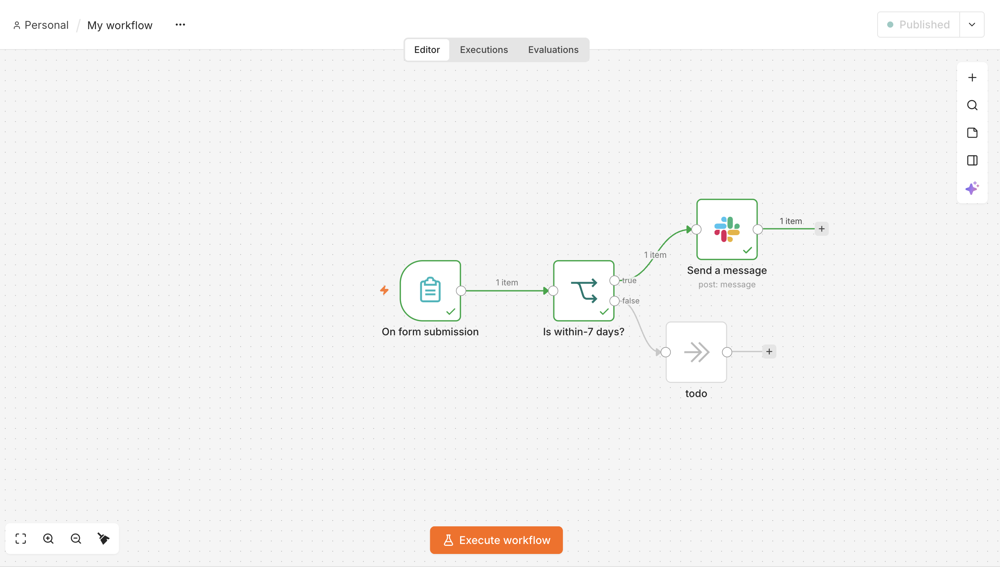

# n8n Form-to-Slack Automation

## Overview
An n8n workflow that collects installation requests through a form, checks the preferred installation date, and sends qualifying requests to a Slack channel.

## Tools Used
- **n8n:** Workflow automation and form submissions
- **Slack:** Notifications for installation requests

## How It Works
1. Users submit their name, email, and preferred installation date.
2. An IF node checks whether the date is within the next seven days.
3. Qualifying requests trigger a Slack notification.
4. Other requests follow a separate branch.

## Setup
1. Import the workflow JSON into n8n.
2. Connect your own Slack credentials.
3. Select your destination Slack channel.
4. Test the workflow before activating it.

## Important Note
The current date condition checks whether the selected date is on or before seven days from now. It does not exclude past dates.
## Workflow Screenshot

## Security
Never publish access tokens, credentials, or private webhook URLs. Remove sensitive information before uploading the workflow to GitHub.
